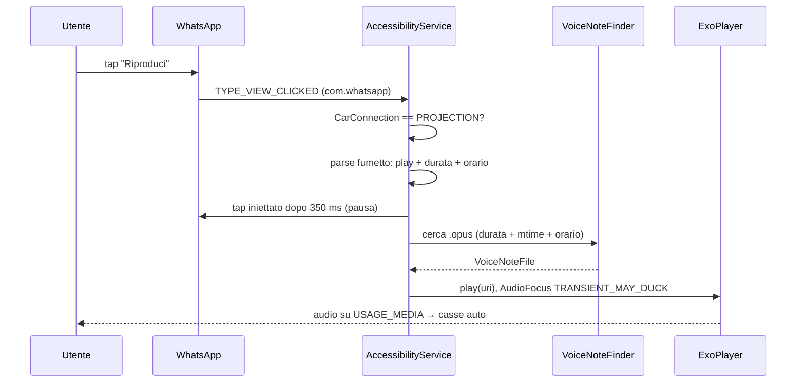

# AA Voice Fix

Intercettore trasparente per le note vocali di WhatsApp quando il telefono è
proiettato su Android Auto.

**Problema:** con Android Auto attivo, il tasto "Riproduci" di un vocale in chat
prende correttamente l'AudioFocus (la musica si abbassa) ma WhatsApp instrada
l'audio su un canale che la proiezione ignora: il vocale è muto. Le app che
usano il canale multimediale (Telegram) si sentono.

**Soluzione:** il servizio di accessibilità riconosce il click sul Play, mette
in pausa il player nativo e riproduce lo **stesso file `.opus`** con
`USAGE_MEDIA` + `CONTENT_TYPE_SPEECH`. Android Auto lo tratta come musica e lo
manda alle casse dell'auto.

Nessun root, nessun Shizuku, nessun ADB a runtime: solo l'installazione
one-shot.

## Flusso



Il servizio resta dormiente finché `CarConnection` non segnala proiezione o
unità nativa: nessun polling, nessun servizio in background aggiuntivo.

## Intercettazione

1. **Android Auto**: `androidx.car.app.connection.CarConnection`, libreria
   AndroidX ufficiale. Nessun evento viene processato se il tipo è
   `CONNECTION_TYPE_NOT_CONNECTED`.
2. **Click**: solo eventi `TYPE_VIEW_CLICKED` del package `com.whatsapp`, con
   `packageNames` già filtrato nel config XML.
3. **Fumetto**: dal nodo cliccato si risale fino a 9 livelli; il sottoalbero
   viene appiattito in `UiNode` e il parser puro cerca:
   - un pulsante con label `Play`/`Riproduci`/`Ascolta`;
   - un contesto vocale (`voice`/`ptt` nel viewId, "messaggio vocale" nella
     descrizione, oppure una `SeekBar`);
   - la durata (`0:24`), il nodo più vicino al Play;
   - l'orario (`18:30`), il nodo più in basso a destra, oppure un
     `contentDescription` esplicito ("alle 18:30").
   I video sono esclusi.
4. **Pausa del player nativo**: il nodo Play viene ricliccato dopo 350 ms. Se il
   nodo è diventato stale, viene ritrovato per `viewId` + bounds. I click
   generati dall'app sono ignorati per 1,5 s: senza questa finestra la pausa
   iniettata riattiverebbe il ciclo.
5. **Match del file**: vedi sotto.
6. **Playback**: Media3 ExoPlayer con `USAGE_MEDIA` e
   `CONTENT_TYPE_SPEECH`; AudioFocus `AUDIOFOCUS_GAIN_TRANSIENT_MAY_DUCK`
   (la musica si abbassa). Focus e player vengono rilasciati a fine traccia.
7. **Toggle**: un click su un vocale mentre l'app sta riproducendo ferma il
   player (e mette comunque in pausa quello nativo).

## Matching del file `.opus`

Directory: `Android/media/com.whatsapp/WhatsApp/Media/WhatsApp Voice Notes/`
(più `Sent/`), ricorsione fino a 3 livelli, ultimi 200 file per mtime.

1. Durata reale letta dal **granule position** dell'ultima pagina Ogg
   (`granule / 48000`), senza decodifica.
2. Si tengono i file con durata entro **1,5 s** da quella mostrata in chat.
3. Tra questi vince il mtime con orario più vicino all'orario del messaggio
   (distanza circolare sulla giornata); a parità, il più recente.
4. Se nessun file ha la durata giusta (o la durata UI non è leggibile),
   fallback all'**ultimo `.opus` modificato**.

## Build

Requisiti: JDK 17+, Android SDK 37. Gradle wrapper incluso.

```bash
./gradlew :app:assembleDebug :app:testDebugUnitTest :app:lintDebug
```

APK: `app/build/outputs/apk/debug/app-debug.apk`.

Test unitari (JVM, nessun device): parser UI WhatsApp, lettura durata Ogg/Opus,
algoritmo di matching.

## Setup via ADB USB (una volta sola)

```bash
./gradlew :app:assembleDebug
./scripts/adb-setup.sh
```

Lo script esegue esattamente:

```bash
# 1. install
adb install -r app/build/outputs/apk/debug/app-debug.apk

# 2. accesso completo ai file (necessario per leggere Android/media/com.whatsapp)
adb shell appops set dev.local.aawafixer MANAGE_EXTERNAL_STORAGE allow

# 3. solo Android <= 12: permesso storage legacy
adb shell pm grant dev.local.aawafixer android.permission.READ_EXTERNAL_STORAGE

# 4. abilita il servizio di accessibilità preservando quelli esistenti
CURRENT="$(adb shell settings get secure enabled_accessibility_services | tr -d '\r')"
adb shell settings put secure enabled_accessibility_services \
  "${CURRENT:-dev.local.aawafixer/dev.local.aawafixer.WaFixAccessibilityService}"
adb shell settings put secure accessibility_enabled 1

# 5. verifica
adb shell appops get dev.local.aawafixer MANAGE_EXTERNAL_STORAGE
adb shell settings get secure enabled_accessibility_services
```

Se `enabled_accessibility_services` era valorizzato, **non sovrascriverlo**:
accoda `:dev.local.aawafixer/dev.local.aawafixer.WaFixAccessibilityService`
(lo script lo fa già).

### Alternativa SAF (senza MANAGE_EXTERNAL_STORAGE)

Nell'app: **Scegli cartella note vocali (SAF)** → seleziona
`WhatsApp Voice Notes`. La tree URI viene resa persistente e usata per
scansionare e riprodurre i file. È più lenta (una query per file) ma non
richiede permessi speciali.

### Disinstallazione / ripristino

```bash
adb shell settings put secure enabled_accessibility_services ""   # oppure rimuovi solo il nostro componente
adb shell appops set dev.local.aawafixer MANAGE_EXTERNAL_STORAGE deny
adb uninstall dev.local.aawafixer
```

Riavvia l'app (o il telefono) dopo aver cambiato `enabled_accessibility_services`.

## Uso

1. Collega il telefono ad Android Auto.
2. Apri l'app **AA Voice Fix**: i tre stati devono essere verdi/attivi
   (Accessibilità ATTIVA, File accesso completo o SAF, Android Auto CONNESSO).
3. In auto apri la chat WhatsApp sul telefono e tocca **Riproduci**.
4. Il vocale parte dalle casse dell'auto. Un secondo tap lo ferma.

## Diagnostica

```bash
adb logcat -s AAWaFixer
```

L'app mostra anche l'ultimo evento e il file scelto nella schermata principale.
Se un vocale resta muto, il log indica quale fase è fallita:

| Messaggio | Significato |
|---|---|
| `click iniettato ignorato` | finestra di soppressione, normale |
| `nessun .opus per durata=… ora=…` | file non trovato: controlla permessi/durata |
| `impossibile mettere in pausa il player nativo` | nodo WhatsApp cambiato |
| niente log dopo il tap | il parser non ha riconosciuto il fumetto |

Per calibrare un aggiornamento di WhatsApp, servono nell'ordine:
`adb shell uiautomator dump` mentre un vocale è visibile, poi confrontare
`viewId` e `contentDescription` con i pattern in
`app/src/main/java/dev/local/aawafixer/WhatsAppUi.kt`.

## Limiti noti

- WhatsApp può cambiare layout/label in qualsiasi aggiornamento: il parser è
  euristico (posizione + keyword). I video sono esclusi esplicitamente.
- Solo note vocali **ricevute/inviate** presenti in `Android/media/...`; i file
  non ancora scaricati non esistono su disco.
- La pausa nativa è un click iniettato: su device molto lenti può arrivare
  dopo l'inizio della riproduzione (350 ms è un compromesso).
- Se il file non viene trovato, il player nativo resta in pausa: meglio muto
  che sul canale sbagliato. Il log dice perché.
- L'app non modifica WhatsApp: nessuna patch, nessun hook, nessun root.
- Su Android 12+ il sistema mostra la notifica delle app di accessibilità.
